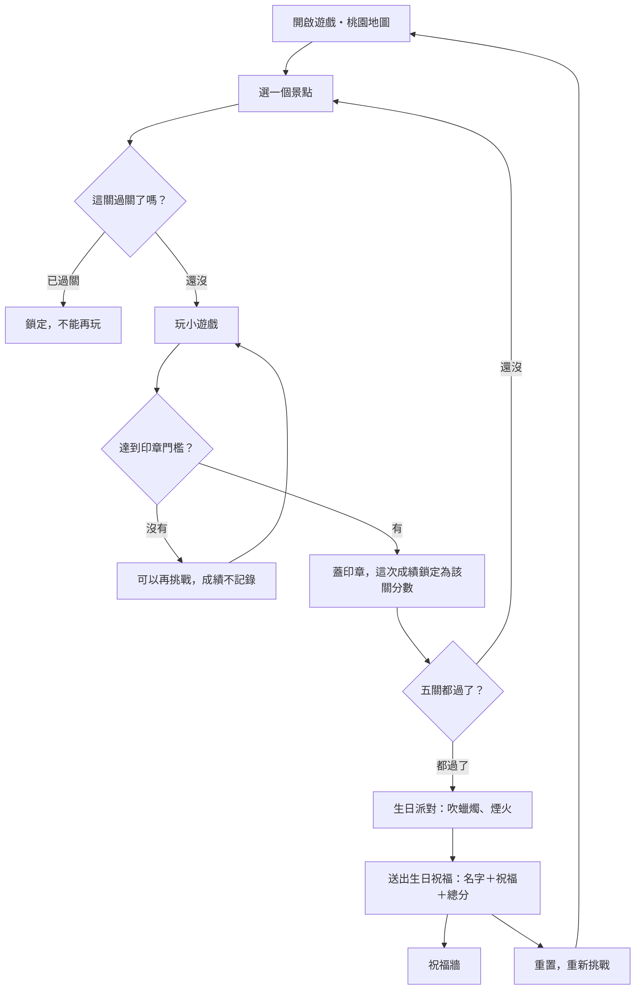

# 觀光大使的生日小旅行：遊戲流程

1/6 舒華生日企劃的粉絲遊戲。玩家在 3D 桃園地圖上挑戰五個景點的小遊戲，五關都過關後，用總分送出一則生日祝福，祝福會出現在祝福牆上，總分越高越顯眼。

## 流程總覽

流程圖原始碼（Mermaid，改流程時請同步更新上面的圖）

## 關卡規則

- 五個關卡可以照任意順序玩。
- **沒過關的關卡可以一直重玩**。沒過關的那幾次分數不會記錄。
- **過關那一次的分數就是該關的成績**，同時蓋上印章，之後這關會鎖定，不能再玩。
- 想再挑戰已過關的關卡，只能在送出祝福後**重置整個進度**。
- 每關都有固定的長度（時間限制或固定回合數），一定會結束。

### 各關門檻與計分

每關有兩個數字：「印章進度」決定能不能過關；「分數」是給排行榜用的細分分數。分數會加入連續的數值（反應時間、剩餘時間、準度等），所以快 0.5 秒也會多一點分數。

| 關卡 | 長度 | 印章門檻 | 分數來源 |
|---|---|---|---|
| 大溪老街・豆干記憶大考驗 | 固定 8 回合，每回合有輸入時限 | 完美完成 5 回合 | 每個正確點擊；完美回合的底分；**剩餘時間越多加成越高**；連續完美的倍率 |
| 拉拉山・接水蜜桃 | 30 秒 | 收成 30 點（水蜜桃 1、金色 3、蜜蜂 −2） | 水蜜桃與金色水蜜桃的底分；**接在籃子越中間越高**；連續接到的倍率；碰到蜜蜂扣分 |
| 石門水庫・划船大冒險 | 40 秒，或撞 3 次就結束 | 漁獲 15 點（魚 1、金色 3） | 魚的底分；**魚跳得越高時接到越高**；**擦身閃過障礙越近越高**；划行距離；剩餘船身；撞到障礙扣分 |
| Xpark・海洋生物找找看 | 40 秒（點錯扣 2 秒） | 找到 10 隻 | 每隻底分；**看到題目後越快點到越高**；連續答對的倍率；點錯扣分 |
| 桃園觀光夜市・夜市限時點餐 | 60 秒 | 完成 8 單 | 依餐點數量給底分；**客人剩下的耐心越多越高**；整單零失誤加分；放錯扣分 |

### 總分

- 總分 = 五關成績的加總（每關都是過關那一次的分數）。
- 地圖右上角的「總分」可以隨時查看各關成績和目前總分。

## 送出生日祝福

- **條件**：五關都過關，每次進度只能送出一次。
- **欄位**：
  - 名字：只能用英文字母、數字、空白，最多 10 個字元。輸入時會自動濾掉其他字元，送出時會去掉頭尾空白，並把連續空白合併成一個。
  - 生日祝福：任何文字，最多 30 個字（以實際看到的字數計算，中文、韓文、表情符號都算 1 個）。
  - 分數：自動帶入目前總分，玩家不能修改。
- **入口**：生日派對結束的祝福卡片，或地圖上的「總分」面板。
- **送出後**：可以前往祝福牆，也可以「重置，重新挑戰」。

## 重置

- 只有送出祝福後才會出現重置按鈕，要按兩次才會執行。
- 重置會清空印章、各關成績和生日派對的紀錄；音效設定保留。
- 已送出的祝福不會因為重置而消失。

## 祝福牆

網頁：`wall.html`（`wall.html#me` 會先冒出自己的祝福）。詳細規格見 [docs/specs/wish-wall.md](docs/specs/wish-wall.md)。

- 背景是遊戲的 3D 桃園地圖，鏡頭慢慢繞島，小狼在各景點之間散步。
- 每則祝福是一張手寫紙條，從島上隨機的地方冒出來、往上飄、再淡出。
- 分數越高，紙條越大、停留越久、出現越頻繁；最低分的祝福也一定會輪到。
- 前三名常駐在拉拉山、Xpark、夜市上方：第 1 名有手繪皇冠，第 2、3 名有手繪獎牌。
- 「排行榜・找我的祝福」打開筆記本：自己的名次、用名字搜尋、完整排行。
- **排名規則**：分數高的在前，同分時先送出的在前。

### 目前是模擬資料

遊戲現在是單機版，祝福牆上的 1,268 筆名單、祝福和分數都是程式產生的測試資料（每次載入都一樣），另外每隔幾秒會模擬一則新祝福送入。玩家自己送出的祝福只存在自己的瀏覽器裡，所以只有自己看得到。

## 資料格式（之後接真正的排行榜用）

每一則祝福：

| 欄位 | 型態 | 說明 |
|---|---|---|
| `name` | 文字 | 1–10 個英文字母、數字或空白 |
| `wish` | 文字 | 1–30 個字 |
| `score` | 整數 | 送出時的總分 |
| `at` | 時間戳 | 送出時間，同分時用來排序 |

## 待決定

- 同一位玩家重置後再送出：要新增一則，還是只保留最高分的那一則？
- 名字重複：允許重複，還是要求不能和別人一樣？
- 真正上線時的防作弊：例如在伺服器端檢查分數的合理範圍。
- 祝福內容的審核：要不要過濾不當文字。
